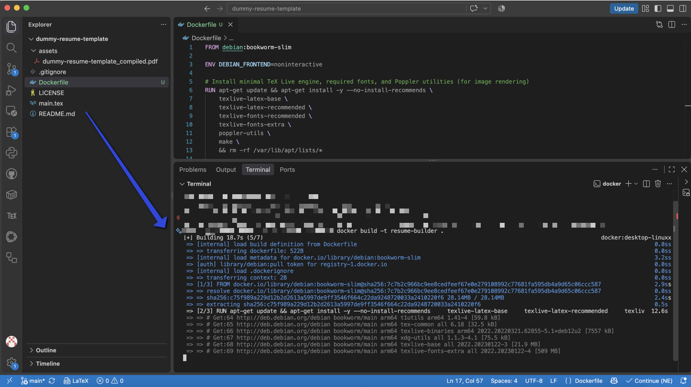
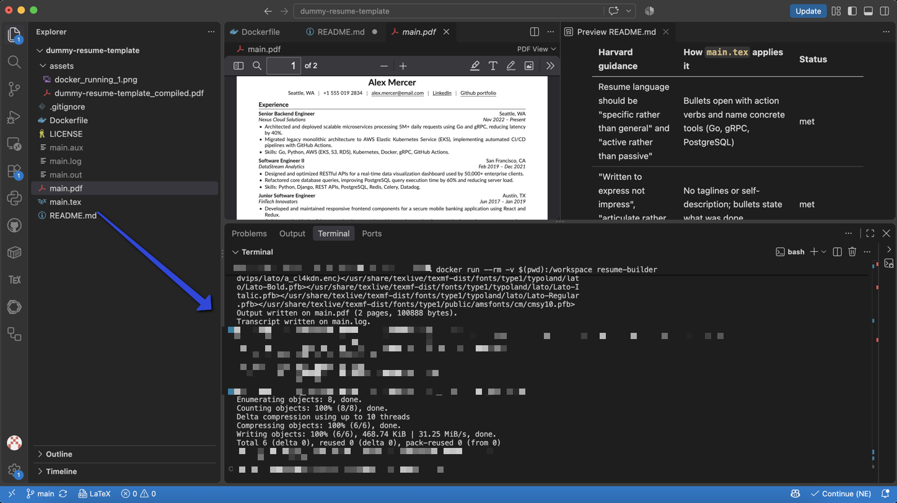

# Dummy template resume

An engineering-grade, single-page LaTeX resume template designed for maximum human legibility and algorithmic parsing efficiency.

This repository implements the visual and structural standards established by the **Harvard University Faculty of Arts and Sciences (FAS) Mignone Center for Career Success**, paired with an ATS-optimized parsing architecture, and a harmonious layout. The document was optimized for ATS friendly standards.

## Design rationale, ATS parsing, and engineering stance

At the core, it follows certain clarity structural guidelines and strong words for sentence structure, like the ones suggested by Harvard's guide to create a great candaitate representation: [College Guide to Creating a Strong Resume](https://careerservices.fas.harvard.edu/resources/create-a-strong-resume/#tips). The design is simple, and the optimization for ATS parsing is strict, based on the researched topic (see the section about [AI-powered recruitment tools (ATS and NLP usage)](#3.-How-applicant-tracking-systems-process-this-resume-(ATS-and-NLP)).

## 1. Name, color and fonts

### Name

"Dummy" here is meant in the foolish  sense, something that is "stupidly simple" and not a placeholder for something. It is a deliberately cheeky anti-label on a product that is carefully built: a resume designed to get through ATS filters, including the ones that count years of experience per skill (AI-optimized applications for recruitment and candidates' profiles analysis).

The resume is dull on purpose. No color accents, no columns, no graphics, nothing for a parser to trip over. The name keeps the project light, quick to use and not too serious about itself.

### Color: soft charcoal

* The color is `RGB(26, 25, 24)`, which is essentially a soft black that should not strain the eye.
* Contrast against white is about 17.6:1, calculated with the WCAG relative luminance formula. Pure black on white is 21:1. Both are well above the 7:1 that WCAG sets for AAA-level normal text. [!] Mini-dislaimer: not a designer myself, I conducted this analysis with an AI tool to get the exact proportions for the luminance formula.
* Color has no effect on ATS parsing, since parsers read the text layer.

### Fonts: Raleway and Lato

* The pair comes from the Deedy-Resume template, which uses Lato and Raleway. These are pretty modern and pleasing to the eye.
* The original Deedy template is compiled with XeLaTeX and `fontspec`. This template instead loads the `lato` and `raleway` packages and is written for pdfLaTeX (`T1` encoding).

## 2. Layout and engineering stance

```latex
\documentclass[10pt,letterpaper]{article}
\usepackage[top=0.5in,bottom=0.5in,left=0.6in,right=0.6in]{geometry}
```

* single column, no images, no text boxes and no floating elements, which removes the usual causes of scrambled reading order in parsers
* each entry header uses one `\entry{...}{...}{...}{...}` macro built on `tabularx`, with the organization and role on the left and place and dates on the right
* margins of 0.5 in (top and bottom) and 0.6 in (sides) are tight, chosen to fit more content per page

### The case for LaTeX over Word

Harvard provides editable resume templates in Microsoft Word and Google Docs. While word processors are accessible, they present distinct drawbacks for technical applications:
* Word documents rely on implicit style engines, loose margin definitions, and cross-platform quirks (a file saved in Word on macOS can wrap lines or break pages differently when opened in Office 365 or LibreOffice).
* LaTeX is the academic standard for scientific publications because it provides deterministic typesetting: compiling the same source code produces the exact same document layout across platforms.
* Compiling to PDF directly via LaTeX gives full micro-typographic control over vertical spacing, exact point sizes, and line breaks, allowing for a compact, disciplined presentation.
* More importantly for automated screening, **writing LaTeX directly gives transparent control over what happens in the background**. You determine the exact structure and sequence of characters emitted into the PDF text layer, avoiding invisible table cells or hidden formatting tags that confuse ATS parsers.

### Against template over-engineering: the single-file stance

A prevalent practice among open-source LaTeX resume templates is excessive modularity. Many popular templates split a short resume across an entire directory tree: a custom `.cls` class file, separate style packages, and individual sub-files for each section (`experience.tex`, `education.tex`, `skills.tex`).

While separation of concerns is a standard software engineering principle for large software systems, applying it to a single-page document introduces needless friction:
* **Fragile build dependencies:** Custom class files frequently rely on specific compilation engines (such as requiring XeLaTeX solely to resolve local font paths) or obsolete package combinations that break across TeX distributions.
* **Macro opacity:** Deeply nested custom wrappers obscure how text is actually laid out, making minor adjustments to margins or spacing difficult.
* **Maintenance overhead:** Updating a single date or editing a bullet point requires opening and coordinating multiple files.

This template adopts the opposite stance: **a single, self-contained `main.tex` file**. It relies exclusively on standard, widely supported packages (`article`, `geometry`, `tabularx`, `titlesec`, `enumitem`, `xcolor`), sets up its entire layout in approximately 40 readable lines of configuration, and keeps all content in one place. It compiles immediately in standard environments (including Overleaf or local TeX installations) without requiring custom class files or external dependencies.

## 3. How applicant tracking systems process this resume (ATS and NLP usage)

### What is established

* An ATS (applicant tracking system) converts an uploaded document into structured data: sections, roles, employers, dates and skills.
* Many ATS products license this parsing from specialist vendors, while others build their own. Textkernel (which absorbed the former Sovren) is one such vendor. Capabilities and what recruiters see differ by product.
* Textkernel's parser reports, for each skill, the total months of use and the last-used date, derived from the dates of the positions in which the skill was found.
* Date extraction and normalization (turning "Nov 2022 -- Present" into a date interval) is a real natural language processing task, called temporal expression extraction and normalization (TimeML and TIMEX3 are the standard annotation schemes).

### A simplified pipeline

The order and names of the stages differ between vendors. This is a general picture, not any one product's design.

```
file upload
    |
    v
text extraction and reading order
    |
    v
section detection (experience, education, skills)
    |
    v
entity extraction (titles, employers, locations, dates, skills)
    |
    v
date normalization ("Nov 2022 -- Present" -> interval)
    |
    v
skill-to-role association (which skills appear in which dated role)
    |
    v
profile aggregation (months per skill) and matching or search
```

### Where natural language processing is used, step by step

Only some stages of the pipeline are natural language processing (NLP). Others are document engineering or plain arithmetic. Each stage below states what happens, which NLP task it corresponds to (if any), and how well that is supported by sources. "Verified" means checked against the primary source (paper, official documentation). "Vendor-stated" means it comes from secondary summaries of vendor material. "Inference" means it is a reasonable reconstruction that no checked source documents.

| # | Stage | NLP task | Is it NLP? |
|---|---|---|---|
| 1 | File upload and text extraction | none (PDF text-layer reading; OCR only for scans) | no |
| 2 | Reading order and layout analysis | geometric grouping, or layout-aware document models | mostly no |
| 3 | Section detection | text classification and sequence labeling | yes |
| 4 | Entity extraction | named entity recognition (NER), dictionary matching | yes |
| 5 | Date normalization | temporal expression extraction and normalization | yes |
| 6 | Skill-to-role association | relation extraction or structural rules, plus entity normalization | partly |
| 7 | Aggregation (months per skill) | none (date arithmetic) | no |
| 8 | Matching and search | keyword retrieval and/or semantic similarity with embeddings | partly |

#### 1. File upload and text extraction (not NLP)

* **What happens:** the parser reads the PDF's text layer, which stores characters with page coordinates. This is file-format handling, not language processing.
* **OCR:** optical character recognition is needed only for scanned or image-only files, and it is a computer vision task. A LaTeX-compiled PDF already has a text layer, so no OCR is needed.
* **Pitfall for this template:** the characters that come out depend on the font encoding (see the ligature note in section 5).

#### 2. Reading order and layout analysis (mostly not NLP)

* **What happens:** characters are grouped into words, lines and text boxes, and the boxes are put in an order. In pdfminer.six (an open-source Python library), layout analysis groups characters into lines and lines into boxes using geometric proximity, producing a hierarchy of layout objects (verified in its documentation). This is a spatial heuristic, not NLP.
* **Layout-aware models:** research models such as LayoutLMv3 combine text with page layout and image features for tasks like form understanding and document layout analysis (verified in the paper's abstract). Whether any ATS vendor uses such a model for resumes is not verified here, so treat it as a possible approach, not a known fact.
* **Why single-column helps:** with one column there is only one plausible reading order, so a simple top-to-bottom grouping is enough.

#### 3. Section detection (NLP: text classification and sequence labeling)

* **What happens:** each line or block is assigned a section type (experience, education, skills, and so on).
* **NLP task:** line-level text classification, or sequence labeling over the lines. Common approaches are heading keyword lists (a gazetteer), or a trained classifier that uses the words plus layout cues such as font size and boldness.
* **Support:** a vendor-stated claim (secondary summaries of Textkernel material) is that machine learning models use visual and linguistic features to find sections even when headings are unusual. The primary vendor documentation was not read. That headings like "Experience" are the easiest case is an inference from how keyword lists and classifiers work, not a documented guarantee.

#### 4. Entity extraction (NLP: named entity recognition)

* **What happens:** spans of text are labeled as job title, employer, location, date, degree, skill and so on.
* **NLP task:** named entity recognition (NER), usually framed as sequence labeling, where each token gets a tag. Typical model families are conditional random fields (CRF), recurrent networks and fine-tuned transformers such as BERT (the BERT paper reports token-level results, including NER, verified in its abstract and paper).
* **Caveat on general tools:** general-purpose libraries such as spaCy provide statistical NER, but their stock English models are trained for general entity types (person, organization, place, date), not resume-specific ones such as "job title" or "skill". Resume parsers need custom-trained models or extra rules.
* **Skills are often not NER:** skills are commonly found by matching text against a skill list or taxonomy. The open-source pyresparser, for example, combines spaCy, NLTK and regular expressions, and matches skills against a CSV list (vendor-stated and secondary; not read in source). Textkernel is described, in secondary summaries, as using deep learning sequence labeling plus skill taxonomies (vendor-stated).

#### 5. Date normalization (NLP: temporal expression extraction and normalization)

* **What happens:** "Nov 2022 -- Present" becomes a start date and an end date.
* **NLP task:** temporal expression extraction and normalization, with TimeML and its TIMEX3 tag as the standard annotation scheme.
* **Tools (verified):** HeidelTime is described in its paper title as "rule-based" (Strötgen and Gertz, SemEval 2010). Stanford SUTime is described on its project page as "a deterministic rule-based system". So the best-known open-source temporal taggers are rule-based, not neural.
* **"Present":** a word like "Present" has no value until it is resolved against a reference date (the date the resume is processed). Resolving this is an explicit step. A resume parser may also do it with a simple regular expression instead of a full temporal tagger (inference).
* **Pairing:** "Nov 2022" and "Present" are two separate expressions. Treating them as the start and end of one interval is an additional rule on top of the tagger (inference).

#### 6. Skill-to-role association (partly NLP)

* **What happens:** each skill is attached to a dated role, so that it inherits that role's time span.
* **NLP task:** in research terms this is relation extraction or record segmentation (which entities belong to the same record). In a resume it can be done mostly with structural rules: a skill found inside a role's block belongs to that role.
* **Normalization:** mapping "JS", "Javascript" and "JavaScript" to one skill is entity normalization (entity linking) against a taxonomy. It can use string matching, or embeddings and similarity.
* **Support:** a vendor-stated claim (Textkernel) is that the parser reports total months and last-used date per skill. How skills are tied to roles internally is not documented in any source checked here, so the "inherits the role's dates" mechanism is an inference.
* **Why this template helps:** a `Skills:` line inside each role puts each skill in the same block as its dates, which is the easiest case for any structural rule.

#### 7. Aggregation (not NLP)

* **What happens:** durations are summed per skill: months between start and end, then added up across roles.
* **Details:** this is date arithmetic. The open questions (are overlapping roles merged or double-counted, is the end month inclusive) are product decisions that differ by vendor. See the worked example below.

#### 8. Matching and search (partly NLP)

* **Keyword retrieval:** classic search over indexed text (for example a ranked keyword index). This is information retrieval and uses basic text processing such as tokenization.
* **Semantic matching:** newer products may compare a resume and a job description through sentence embeddings and cosine similarity. Sentence-BERT is the standard reference for this technique: it produces sentence embeddings that "can be compared using cosine-similarity" (verified in its abstract). Which ATS products actually use this is vendor-specific and not verified here.

"Skill-experience mapping" and "temporal extraction" are descriptive labels. They are not standard product terms, apart from temporal expression extraction as described above.

#### Evidence from real products: per-skill experience

Question: do real products compute years or months of experience per skill across several jobs? Short answer: yes for at least one major parser, with a documented output format, but the internal method is not public, and the primary documentation could not be read here.

| Product | What it reportedly outputs | Evidence type | Confidence |
|---|---|---|---|
| Textkernel (includes the former Sovren) | for each skill: a normalized name, months of experience, a last-used date, and a list of the resume positions where the skill was found | consistent across several search summaries of Textkernel developer documentation; the developer portal itself returned an access error (403) and Sovren's docs site failed a TLS check | medium to high |
| RChilli | per-skill "experience in months" and "last used" | one search summary, whose JSON example was explicitly labeled conceptual | low |
| Affinda | per-skill duration is reportedly not part of the standard output; users correlate the skills list with work-experience dates themselves | one search summary | low |
| HireAbility, Daxtra | summaries mention total experience and recent competencies; no per-skill month counts were confirmed | search summary of marketing material | low |

What the Textkernel evidence says, in more detail (all from secondary summaries):

* the skill object carries a months-of-experience value and a last-used value, derived from the dates of the positions where the skill was found
* a "found in" field points to the positions that supported each skill, which fits the skill-to-role association described in step 6
* a position that is still ongoing is marked with a placeholder, and the document's last-modified date supplied with the request is used to anchor "now" (compare step 5, resolving "Present" against a reference date)
* skills are normalized against a taxonomy, so synonyms are counted together

What this does and does not show:

* **Shown (medium to high confidence):** at least one widely used parser produces per-skill months and last-used output computed from dated positions. This supports the premise behind the `Skills:` line inside each role.
* **Not shown:** how the months are computed. Whether overlapping jobs are merged or double-counted, how skills are linked to positions, and which NLP models are used internally are not published in anything checked here. The earlier statement that this is "powered by NLP" is true for the extraction steps (3 to 5) but is not documented for the arithmetic itself (step 7).
* **Not shown:** that this output is used to rank or reject candidates. In many systems it is a searchable field that recruiters filter on, which is different from automatic scoring.
* **Possible variation:** the same resume can yield different months in different products, so the worked example below is an illustration, not a prediction.

To raise the confidence level, read the Textkernel developer portal's resume parsing data model directly (it needs a browser or an account), or run the compiled PDF through a vendor's public demo parser and compare the output with the worked example.

#### Corrections to an earlier draft

An earlier version of this section contained errors that were found during fact-checking and removed:

* a citation attributed to a BERT-based NER paper pointed at an unrelated astrophysics paper
* the sentence-embedding citation pointed at a multilingual-distillation paper instead of Sentence-BERT
* the HeidelTime reference had a DOI that does not resolve
* the claim that the open-source ResumeParser "inherits the most recent date span" had no source and was removed
* the claims that ATS products use LayoutLMv3 or Elasticsearch were unsupported and were removed

#### References

* Devlin et al. (2018). BERT: pre-training of deep bidirectional transformers for language understanding. https://arxiv.org/abs/1810.04805
* Huang et al. (2022). LayoutLMv3: pre-training for Document AI with unified text and image masking. https://arxiv.org/abs/2204.08387
* Reimers and Gurevych (2019). Sentence-BERT: sentence embeddings using Siamese BERT-networks. https://arxiv.org/abs/1908.10084
* Strötgen and Gertz (2010). HeidelTime: high quality rule-based extraction and normalization of temporal expressions. https://aclanthology.org/S10-1071/
* Stanford SUTime project page. https://nlp.stanford.edu/software/sutime.shtml
* pdfminer.six documentation, layout analysis algorithm. https://pdfminersix.readthedocs.io/en/latest/topic/converting_pdf_to_text.html
* spaCy documentation, linguistic features. https://spacy.io/usage/linguistic-features#named-entities

### Worked example from this resume

Months are counted inclusively from the stated start month to the stated end month, with "Present" taken as October 2026. Vendors may count differently, and how overlapping roles are combined is vendor-specific.

| Skill | Roles whose `Skills:` line lists it | Months | Years |
|---|---|---|---|
| Python | Nexus (48), DataStream (35), Pioneer (8), Nimbus (3) | 94 | about 7.8 |
| JavaScript | FinTech (20), Nimbus (3) | 23 | about 1.9 |
| Go | Nexus (48) | 48 | 4.0 |

These totals grow with every month that "Present" moves forward.

### Why per-role skills lines help

A skill listed only in a separate skills section has no dated role attached, so a parser has nothing to compute a duration from. With a `Skills:` line inside each role (lines 71, 81, 91, 101 and 111 of `main.tex`), each technology sits next to a date range. Whether a given parser gives zero duration to skills outside any role is vendor-specific and was not verified.

### Other design choices that help

* common section names (Experience, Education) are the easiest for parsers to recognize, though no heading guarantees correct classification
* a consistent `Mon YYYY -- Mon YYYY` date format is easy to parse
* single-column text gives a simple reading order

### Not every ATS ranks automatically

Some systems rely mainly on recruiter review and keyword search, not on automatic scoring. This template makes the data easier to extract either way, but there is no evidence here of how any specific product would rank it.

## 5. Open items and what was not verified (yet)

* **Text extraction from the PDF:** untested. With pdfLaTeX and `T1` fonts, ligatures such as "fi" can extract incorrectly unless the document loads `cmap` or sets `\input{glyphtounicode}` and `\pdfgentounicode=1`. `main.tex` does neither. Check by copying text out of the PDF.
* **Table-based entry headers:** the `tabularx` rows should extract row by row, but this was not tested.
* **Combined headings:** "Projects and activities" and "Skills and interests" are less conventional than separate "Projects" and "Skills" headings. Parser behavior on them was not tested.
* **Vendor behavior:** statements about Textkernel, RChilli, Affinda, HireAbility and Daxtra come from search summaries of vendor material, not from the primary documents; **for now, a direct confirmation of the inner mechanics of their tools can not be 100% verrified, since, for example, the internal method for computing months per skill is not public.** {This section specifically is pending.}


## 4. Harvard guidance and how the template applies it

The Harvard page gives rules about language, content and ordering. It does not prescribe fonts, colors or a resume page limit (the only page limit on the page is for cover letters: "no more than a single page"). The choices of typography and color discussed in earlier sections are therefore the author's own design decisions, not Harvard guidance.

Quotes in the table are taken verbatim from the page's "Quick Tips" section.

| Harvard guidance | How `main.tex` applies it | Status |
|---|---|---|
| Resume language should be "specific rather than general" and "active rather than passive" | Bullets open with action verbs and name concrete tools (Go, gRPC, PostgreSQL) | met |
| "Written to express not impress", "articulate rather than 'flowery'" | No taglines or self-description; bullets state what was done | met |
| "Fact-based (quantify and qualify)" | Metrics in most experience bullets (5M+ requests, 40% latency, 60% query time, 45% to 85% coverage, 10 hours per week) | partly: the mentoring, reading-group and several education bullets have no figures |
| "Written for people who / systems that scan quickly" | Single column, short bullets, consistent entry headers | met |
| Don't use personal pronouns | None present | met |
| Don't include a picture, age or gender; don't list references | None present | met |
| Don't "start each line with a date" | Dates sit at the right of each entry header | met |
| "Within headings, list information in reverse chronological order" | Experience, education and projects are each ordered most recent first | met |
| "Avoid information gaps such as a missing summer" | The sample dates leave about 17 months between Nimbus Dynamics (ends Apr 2015) and Pioneer Software (starts Oct 2016), and about 10 months between DataStream (ends Dec 2021) and Nexus (starts Nov 2022). The second overlaps the M.S. studies | not met in the sample data |
| "Don't abbreviate" | Technical acronyms (AWS, gRPC, CI/CD, HCI) and degree abbreviations (B.S., M.S.) are used | partly: justified for technical terms, but worth knowing the guidance exists |
| "Use consistent spacing, underlining, italics, bold, and capitalization" | One `\entry` macro formats every header | met |
| "Be sure that your formatting will translate properly if converted to a .pdf" | Output is a LaTeX-generated PDF | see section 4 for what was and was not tested |

### Action verbs

Harvard publishes a categorized action verb list. Checking the verbs that open bullets in `main.tex` against it:

* on the list: designed, developed, collaborated, created, authored, built, assisted, organized, coordinated, provided, optimized, implemented
* not on the list: architected, migrated, refactored

Using verbs outside the list is not a problem in itself. The list is a suggestion, not a requirement.

### Persona

The page asks that a resume "authentically represent who you are and what you have to offer." In this template the persona is built from the sample content: a backend engineer with a cognitive psychology minor, a summer school at the Santa Fe Institute, community activities and specific interests. This is a content choice by the author. The page text does not say anything about including an interests section.

## Customization, Docker containerized compilation, and automated visual pipeline

After defining the base resume set up and prerequisites, I have added the local `Dockerfile` that will automatically run the compilation of the resume in a container. One only needs to build the Docker image one time; as such, after building the image once and mounting the current working directory as a volume (`-v $(pwd):/workspace`), the compiling can be done in a few seconds.

This creates much more flexibility in local testing and comes with extra advantages: 
* **Zero-host pollution** - if running this on a Mac, the TeX distributions (e.g. LaTeX, pdfLaTeX) are famously challenging to set up and consume a lot of space on disk (3 to 6 GB). Using a dedicated Docker image allows for a minimal consumption footprint, since it installs only the required packages.

```bash
docker build -t resume-builder .
```
* **Binary determinism and front-end elements matching** - regardless of your local machine's configuration, the Raleway and Lato packages will render indentically across macOS, Windows, or Linux distributions without having to deal with the missing system fonts.
```bash
docker run --rm -v $(pwd):/workspace resume-builder
```




